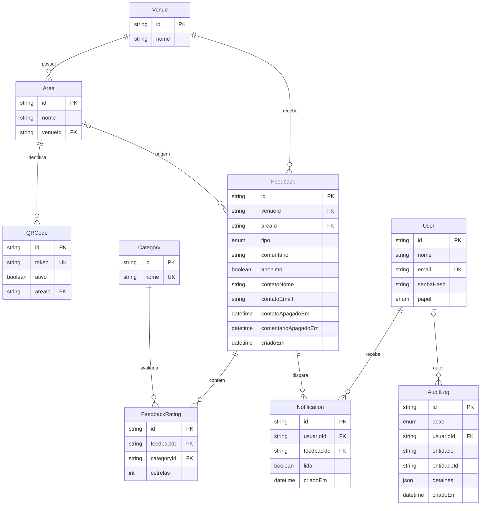

# Modelo de dados — MVP 1 (v1 · rascunho para revisão)

> Escopo: entidades necessárias para a entrega de **27/08** (feedback do cliente + login da gestão).
> Schema Prisma correspondente: [`api/prisma/schema.prisma`](../api/prisma/schema.prisma).
> Primeira versão para o time de Banco (Nicholas + Cauan) revisar com o backend no Bloco 1.

## Diagrama ER

## Entidades

| Entidade | Papel | Campos principais |
|---|---|---|
| **User** | Usuário de gestão que faz login | `nome`, `email` (único), `senhaHash`, `papel`, `avisoPorEmail` (padrão `RECLAMACOES`) |
| **Venue** | O restaurante | `nome` |
| **Area** | Mesa / área / setor do restaurante | `nome`, `ativo`, `venueId` — único por `(venueId, nome)` |
| **QRCode** | QR físico que aponta para uma área | `token` (único), `ativo`, `areaId` |
| **Category** | Categoria avaliável | `nome` (ex.: Higiene, Atendimento, Alimento) |
| **Feedback** | Manifestação enviada pelo cliente | `tipo`, `comentario`, `anonimo`, `contatoNome`, `contatoEmail`, `contatoApagadoEm?`, `comentarioApagadoEm?`, `venueId`, `areaId?`, `criadoEm` |
| **FeedbackRating** | Nota por categoria de um feedback | `estrelas` (1–5), `feedbackId`, `categoryId` |
| **Notification** | Alerta de feedback novo para uma pessoa da gestão | `usuarioId`, `feedbackId`, `lida`, `criadoEm` — único por `(usuarioId, feedbackId)` |
| **Resposta** | Resposta da equipe ao cliente, enviada por e-mail pelo Echo | `feedbackId`, `autorId`, `texto?` (sai com o contato, pela retenção), `textoApagadoEm?`, `enviadaEm` |
| **RespostaPronta** | Modelo que a equipe escolhe ao responder o cliente | `titulo` (único), `texto`, `ativo`, `criadoEm`, `atualizadoEm` |
| **AuditLog** | Quem fez o quê, sobre qual registro e quando | `acao`, `usuarioId?` (vazio: o próprio sistema), `entidade`, `entidadeId`, `detalhes` (JSON), `criadoEm` |
| **Configuracao** | Configurações do sistema, numa linha única (`id = "sistema"`) | `duracaoSessaoHoras` (padrão 8), `retencaoContatoDias` (90), `retencaoComentarioDias` (365), `retencaoNotificacaoDias` (90), `ultimaRetencaoEm?`, `atualizadoEm` |

## Enums
- **Papel:** `COORDENADOR` · `GERENTE` · `ADMINISTRADOR` *(Cliente não faz login)*
- **TipoFeedback:** `ELOGIO` · `SUGESTAO` · `RECLAMACAO`
- **AvisoPorEmail:** `NENHUM` · `RECLAMACOES` · `TODOS` *(quais feedbacks novos chegam por e-mail a cada pessoa)*
- **AcaoAuditoria:** `LOGIN` · `SENHA_ALTERADA` · `SENHA_REDEFINIDA` · `USUARIO_CRIADO` · `USUARIO_EDITADO` ·
  `USUARIO_DESATIVADO` · `USUARIO_REATIVADO` · `AREA_CRIADA` · `AREA_RENOMEADA` · `AREA_DESATIVADA` ·
  `AREA_REATIVADA` · `QRCODE_GERADO` · `QRCODE_DESATIVADO` · `QRCODE_REATIVADO` · `OCORRENCIA_STATUS` ·
  `CONFIGURACAO_ALTERADA` · `RETENCAO_APLICADA` · `DADOS_DO_TITULAR_APAGADOS` · `AVISO_POR_EMAIL_ALTERADO` · `RESPOSTA_ENVIADA` ·
  `RESPOSTA_PRONTA_CRIADA` · `RESPOSTA_PRONTA_EDITADA` · `RESPOSTA_PRONTA_DESATIVADA` · `RESPOSTA_PRONTA_REATIVADA`

## Decisões e observações
- **Anonimato por padrão:** `Feedback.anonimo = true`. `contatoNome` e `contatoEmail` só são gravados quando o cliente pede resposta da equipe (sem e-mail, o feedback é gravado como anônimo). O contato só sai da API no detalhe da ocorrência, para quem vai responder; nunca em listas (LGPD).
- **Um feedback tem várias notas:** a relação `Feedback → FeedbackRating` permite avaliar **múltiplas categorias** de uma vez.
- **`Feedback.areaId` é opcional:** cobre o caso de um QR genérico (do restaurante, não de uma mesa específica).
- **Índice** em `Feedback(venueId, criadoEm)** para acelerar a listagem da gestão por data.
- **Nome da área é único dentro do restaurante** (`@@unique([venueId, nome])`): duas "Mesa 12" no mesmo
  lugar viravam duas barras indistinguíveis no dashboard. Entre restaurantes o nome pode repetir, porque
  toda casa tem a sua "Mesa 1". A constraint é por **texto exato** — quem for criar o `POST /areas` precisa
  aplicar `trim()` no nome, senão `"Mesa 1"` e `"Mesa 1 "` passam como áreas diferentes. Por isso a API
  também confere o nome **sem diferenciar maiúsculas** antes de criar ou renomear: `"mesa 1"` ao lado de
  `"Mesa 1"` passava pela constraint.
- **Comparar sem diferenciar maiúsculas passa por `semCuringas`** (`src/consulta.ts`). O
  `mode: "insensitive"` do Prisma vira `ILIKE` no Postgres sem escapar nada: `"Mesa_1"` era recusada
  como repetida de `"Mesa 1"`, a busca `%` trazia tudo e uma barra invertida sumia. Vale para toda
  consulta nova com `mode: "insensitive"`.
- **"Ocorrência" no MVP 1** = um `Feedback`. Status, tratativa e respostas prontas viram entidades próprias no **MVP 2**.

- **`AuditLog` só cresce.** Nenhuma rota edita ou apaga linha. `entidadeId` é texto sem chave
  estrangeira, de propósito: o registro precisa sobreviver ao alvo. E `detalhes` guarda o nome do alvo
  na hora da ação, para que renomear depois não reescreva o passado. É gravado na **mesma transação**
  da ação que registra. Ver `GET /api/audit` no [contrato](CONTRATO-API.md).
  `usuarioId` vazio é o próprio sistema, sem ninguém logado (hoje só a retenção automática). A
  chave estrangeira continua `RESTRICT`: apagar um usuário não pode fazer as ações dele virarem
  "Sistema".

- **`Notification` é uma linha por destinatário**, não uma por feedback: cada pessoa tem o próprio
  "lida". Não guarda texto — a mensagem vem do feedback na leitura —, e por isso apaga em cascata com
  ele. Criada junto com o feedback para toda a gestão ativa; quem entra na equipe depois não herda
  alertas antigos.

- **`Configuracao` é uma linha só, com uma coluna tipada por configuração** — não uma tabela
  chave/valor em texto, que aceitaria "oito" como duração. Enquanto ninguém salva nada a linha não
  existe e valem os padrões das colunas.

- **Retenção (LGPD): anonimiza, não apaga o feedback.** Passado o prazo, a rotina (`src/retencao.ts`)
  limpa `contatoNome`/`contatoEmail` e o `comentario` e anota quando (`contatoApagadoEm`,
  `comentarioApagadoEm`); as notificações velhas são apagadas. Tipo, notas, área, data e situação
  ficam, e os números dos painéis não mudam. Os prazos ficam na `Configuracao`. Ver a seção 23 do
  [contrato](CONTRATO-API.md).

## Fora do escopo (MVP 2+)
`Occurrence` (com status/tratativa), `CannedResponse`, `Sector` (múltiplos setores por usuário) e políticas de retenção/anonimização automática.
